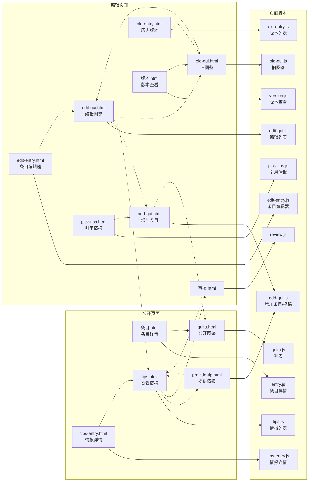
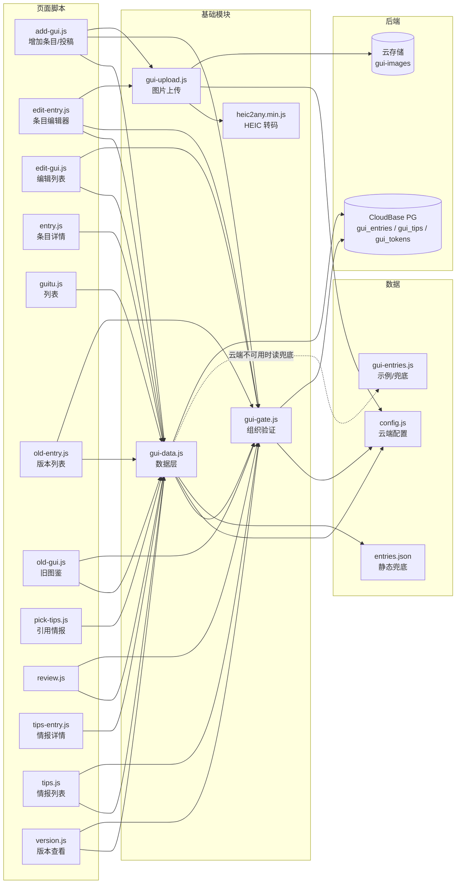

# 鬼图鉴 · 架构图

页面、脚本、数据、后端之间的依赖关系。这张图由脚本从源码推导，**不要手改生成区间**。

<!-- AUTO-GENERATED:START 由 _local/tools/build-docs.js 生成，勿手工编辑本区间 -->
**13** 个页面 · **15** 个脚本 · **59** 条依赖边

## 一、页面 与 页面脚本

实线 = 页面加载该脚本，虚线 = 页面之间可以互相跳转。



## 二、脚本依赖 与 后端

页面脚本只依赖基础模块，彼此之间**没有任何横向依赖**——这是可以单独改动一个页面的前提。

为免连线拥挤，图里省略了「各页面脚本调用 `gui-entries.js` 里的占位图函数（guiImageFor / guiThumbFor 等）」这一层：那是渲染辅助，不是架构依赖。



## 三、每个页面加载的脚本

页面都加载的两个数据文件在表里用 ✓ 标出；末尾一列是该页自己的逻辑脚本。

| 页面 | config | gui-entries | gui-gate | gui-data | gui-upload | 该页自己的脚本 |
|---|:-:|:-:|:-:|:-:|:-:|---|
| `add-gui.html` | ✓ | ✓ | ✓ | ✓ | ✓ | `add-gui.js` |
| `edit-entry.html` | ✓ | ✓ | ✓ | ✓ | ✓ | `edit-entry.js` |
| `edit-gui.html` | ✓ | ✓ | ✓ | ✓ | · | `edit-gui.js` |
| `guitu.html` | ✓ | ✓ | · | ✓ | · | `guitu.js` |
| `old-entry.html` | ✓ | ✓ | ✓ | ✓ | · | `old-entry.js` |
| `old-gui.html` | ✓ | ✓ | ✓ | ✓ | · | `old-gui.js` |
| `pick-tips.html` | ✓ | ✓ | ✓ | ✓ | · | `pick-tips.js` |
| `provide-tip.html` | ✓ | ✓ | ✓ | ✓ | ✓ | `add-gui.js` |
| `tips-entry.html` | ✓ | ✓ | ✓ | ✓ | · | `tips-entry.js` |
| `tips.html` | ✓ | ✓ | ✓ | ✓ | · | `tips.js` |
| `审核.html` | ✓ | ✓ | ✓ | ✓ | · | `review.js` |
| `条目.html` | ✓ | ✓ | · | ✓ | · | `entry.js` |
| `版本.html` | ✓ | ✓ | ✓ | ✓ | · | `version.js` |
<!-- AUTO-GENERATED:END -->

---

## 怎么更新

改完代码后执行一次生成脚本，只覆盖上面的标记区间：

```
node _local/tools/build-docs.js
```

## 怎么读

| 层 | 内容 |
|---|---|
| 数据 | 云端配置、示例条目、静态兜底 |
| 基础模块 | 被所有页面共用：数据层、组织验证、图片上传 |
| 页面脚本 | 每个页面对应的逻辑，互不依赖 |
| 公开页面 | 不需要验证，任何人可看 |
| 编辑页面 | 需要组织验证，写入数据库 |
| 后端 | CloudBase PostgreSQL 与云存储 |

面向访客的界面跳转图见 [访客流程图.md](访客流程图.md)。
