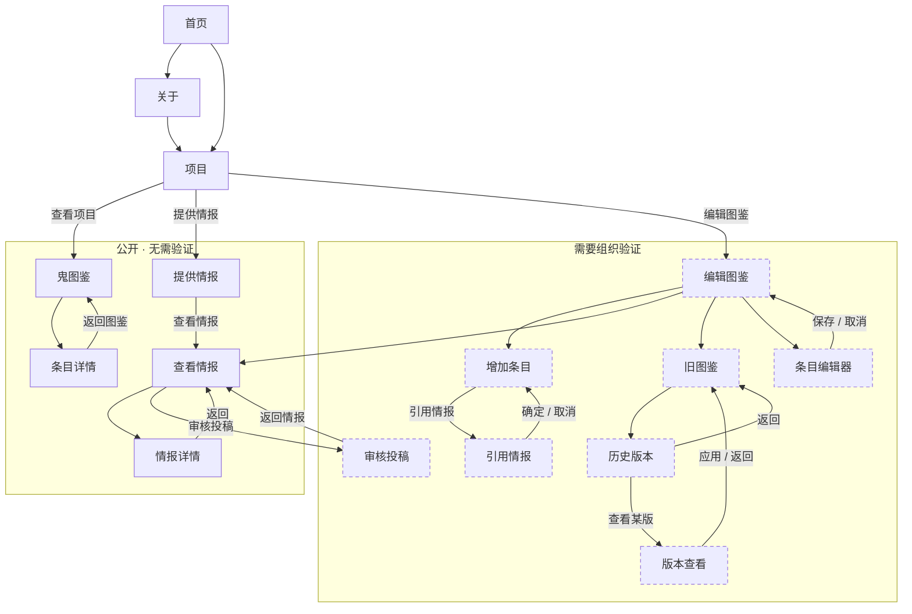

# 鬼图鉴 · 界面跳转

这张图只说明**界面上点哪里能到哪里**，不涉及代码、数据库和服务器。

每个页面顶部的「首页 / 关于 / 项目」导航是所有页面都有的，为了画面清爽没有逐条画出。

## 怎么读

| 记号 | 含义 |
|---|---|
| 实线箭头 | 点按钮或链接可以过去 |
| 箭头上的文字 | 那个按钮叫什么 |
| 虚线边框 | 进去之前要先回答组织验证问题 |

## 几条主要路径

**随便看看**：项目 → 鬼图鉴 → 点某个条目看详情。

**投稿线索**：项目 → 提供情报 → 填写提交 → 查看情报。投稿不需要验证。

**编纂条目**：项目 → 编辑图鉴（答验证题）→ 增加条目 → 可选「引用情报」把已有情报合并进来。

**改错了想撤回**：编辑图鉴 → 旧图鉴 → 点条目 → 选某个历史版本 → 应用。
