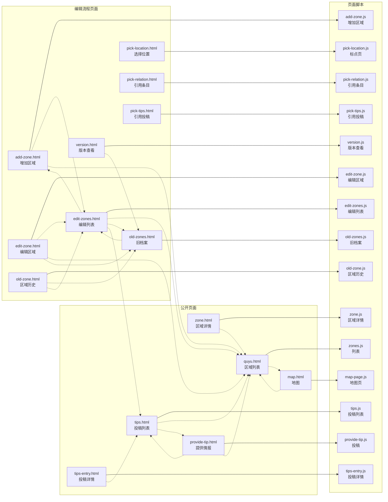
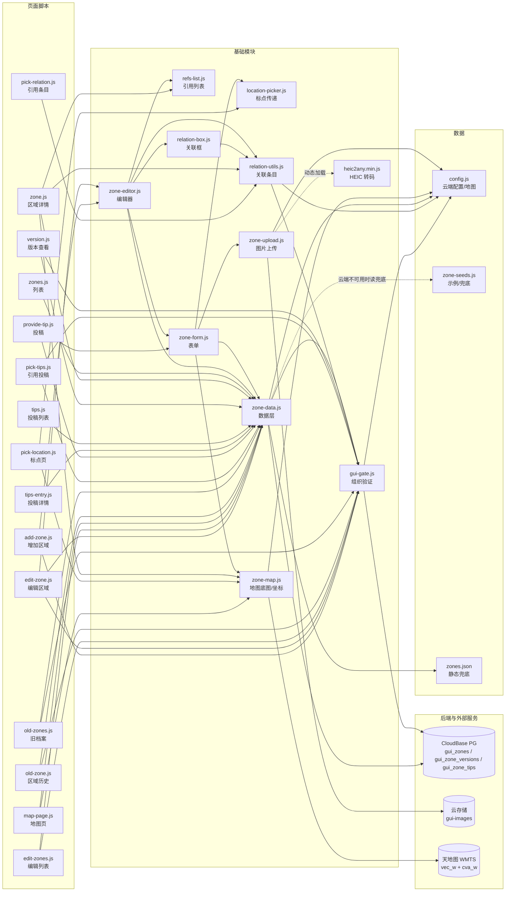

# 异常区域档案 · 架构图

页面、脚本、数据、后端之间的依赖关系。标记区间由脚本生成、**不要手改**；区间外的说明是手写的。两边冲突时以代码为准。

<!-- AUTO-GENERATED:START 由 _local/tools/build-docs.js 生成，勿手工编辑本区间 -->
**15** 个页面 · **25** 个脚本 · **89** 条依赖边

扫描得到：页面清单、页面→脚本、页面→页面（只认 HTML 里的 href）、脚本→基础模块（按 `window.X` 归属）。
写死的：基础模块之间的边、模块→数据/后端、每页的访问级别。这几处改代码不会自动更新，冲突时以代码为准。

## 一、页面 与 页面脚本

实线 = 页面加载该脚本，虚线 = 页面之间可以互相跳转。



## 二、脚本依赖 与 后端

页面脚本只依赖基础模块，彼此之间**没有任何横向依赖**。

基础模块里 `gui-gate.js` 是从鬼图鉴原样复制的，与鬼图鉴共用同一套组织验证和数据库令牌；`zone-upload.js` 复用的 HEIC 库也来自 `guitu/js/lib/`。



## 三、每个页面加载的脚本

两个数据文件用 ✓ 标出；「其它基础模块」由各页脚本的依赖推导。

| 页面 | config | zone-seeds | gui-gate | location-picker | refs-list | relation-box | relation-utils | zone-data | zone-editor | zone-form | zone-map | zone-upload | 该页自己的脚本 |
|---|:-:|:-:|:-:|:-:|:-:|:-:|:-:|:-:|:-:|:-:|:-:|:-:|---|
| `quyu.html` | ✓ | ✓ | · | · | · | · | · | ✓ | · | · | · | · | `zones.js` |
| `map.html` | ✓ | ✓ | · | · | · | · | · | ✓ | · | · | ✓ | · | `map-page.js` |
| `zone.html` | ✓ | ✓ | · | · | ✓ | · | ✓ | ✓ | · | · | ✓ | · | `zone.js` |
| `tips.html` | ✓ | ✓ | · | · | · | · | · | ✓ | · | · | · | · | `tips.js` |
| `tips-entry.html` | ✓ | ✓ | · | · | · | · | · | ✓ | · | · | · | · | `tips-entry.js` |
| `provide-tip.html` | ✓ | ✓ | ✓ | ✓ | · | · | · | ✓ | · | ✓ | ✓ | ✓ | `provide-tip.js` |
| `add-zone.html` | ✓ | ✓ | ✓ | ✓ | ✓ | ✓ | ✓ | ✓ | ✓ | ✓ | ✓ | ✓ | `add-zone.js` |
| `edit-zone.html` | ✓ | ✓ | ✓ | ✓ | ✓ | ✓ | ✓ | ✓ | ✓ | ✓ | ✓ | ✓ | `edit-zone.js` |
| `edit-zones.html` | ✓ | ✓ | ✓ | · | · | · | · | ✓ | · | · | · | · | `edit-zones.js` |
| `old-zone.html` | ✓ | ✓ | ✓ | · | · | · | · | ✓ | · | · | · | · | `old-zone.js` |
| `old-zones.html` | ✓ | ✓ | ✓ | · | · | · | · | ✓ | · | · | · | · | `old-zones.js` |
| `pick-location.html` | ✓ | ✓ | · | ✓ | · | · | · | · | · | · | ✓ | · | `pick-location.js` |
| `pick-relation.html` | ✓ | ✓ | · | · | · | · | ✓ | · | · | · | · | · | `pick-relation.js` |
| `pick-tips.html` | ✓ | ✓ | ✓ | · | · | · | · | ✓ | · | · | · | · | `pick-tips.js` |
| `version.html` | ✓ | ✓ | ✓ | · | · | · | · | ✓ | · | · | · | · | `version.js` |

上表只列本模块的脚本；跨模块引用见第五节。

## 四、反向依赖（改之前先看影响面）

两张数：有多少页面直接加载它、有多少脚本（含基础模块）依赖它。0 表示没有静态引用——动态加载或运行时读取。

| 文件 | 直接加载它的页面 | 依赖它的脚本 |
|---|---|:-:|
| `gui-gate.js` | 8 | 9 |
| `location-picker.js` | 4 | 2 |
| `refs-list.js` | 3 | 2 |
| `relation-box.js` | 2 | 1 |
| `relation-utils.js` | 4 | 4 |
| `zone-data.js` | 13 | 14 |
| `zone-editor.js` | 2 | 2 |
| `zone-form.js` | 3 | 2 |
| `zone-map.js` | 6 | 4 |
| `zone-upload.js` | 3 | 1 |
| `heic2any.min.js` | 0 | 0 |
| `config.js` | 15 | 5 |
| `zone-seeds.js` | 15 | 3 |
| `zones.json` | 0 | 0 |

每个页面脚本都只被一个页面加载，改页面脚本只影响那一页。

## 五、跨模块引用

本模块的页面直接加载对方的文件：

| 页面 | 直接加载的文件 |
|---|---|
| `map.html` | `quyu/vendor/leaflet/leaflet.js` |
| `zone.html` | `quyu/vendor/leaflet/leaflet.js` |
| `provide-tip.html` | `quyu/vendor/leaflet/leaflet.js` |
| `add-zone.html` | `quyu/vendor/leaflet/leaflet.js` |
| `edit-zone.html` | `quyu/vendor/leaflet/leaflet.js` |
| `pick-location.html` | `quyu/vendor/leaflet/leaflet.js` |

对方的页面直接加载本模块的文件（改这些会同时影响对方）：

| 页面 | 直接加载的文件 |
|---|---|
| `条目.html` | `quyu/data/zone-seeds.js`、`quyu/js/relation-utils.js`、`quyu/js/refs-list.js` |
| `add-gui.html` | `quyu/js/relation-utils.js`、`quyu/js/relation-box.js` |
| `edit-entry.html` | `quyu/js/relation-utils.js`、`quyu/js/refs-list.js`、`quyu/js/relation-box.js` |

第四节只数本模块的页面；`relation-utils.js` / `relation-box.js` / `refs-list.js` 还被 guitu 的页面直接加载。`gui-gate.js` 是从 guitu 复制的副本，改验证逻辑要两边各改一次。
<!-- AUTO-GENERATED:END -->

---

## 怎么更新

改完代码后执行一次生成脚本，只覆盖上面的标记区间：

```
node _local/tools/build-docs.js
```

## 怎么读

| 层 | 内容 |
|---|---|
| 数据 | 云端配置与地图 key、示例区域、静态兜底 |
| 基础模块 | 被多个页面共用：数据层、组织验证、上传、地图、关联、引用、表单 |
| 页面脚本 | 每个页面对应的逻辑，互不依赖 |
| 公开页面 | 不需要验证，任何人可看 |
| 编辑流程页面 | 需要组织验证，或只在编辑过程中出现 |
| 后端 | CloudBase PostgreSQL、云存储、天地图 WMTS |

面向访客的界面跳转图见 [访客流程图.md](访客流程图.md)。与鬼图鉴的关系见
[../guitu/架构.md](../guitu/架构.md)：两边共用 `gui-gate.js` 与数据库令牌，
条目之间通过 `related` 字段互相引用。
