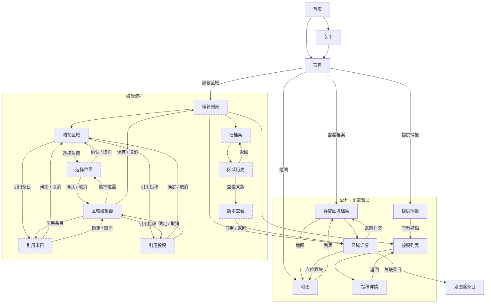

# 异常区域档案 · 界面跳转

这张图只说明**界面上点哪里能到哪里**，不涉及代码、数据库和服务器。

每个页面顶部的「首页 / 关于 / 项目」导航是所有页面都有的，为了画面清爽没有逐条画出。

## 怎么读

| 记号 | 含义 |
|---|---|
| 实线箭头 | 点按钮或链接可以过去 |
| 箭头上的文字 | 那个按钮叫什么 |
| 虚线边框 | 编辑流程里的页面：写入前要过组织验证，或者只在编辑过程中出现 |

## 几条主要路径

**随便看看**：项目 → 异常区域档案 → 点某个区域看详情；也可以直接进地图，从标记或侧栏定位。

**对着地图找**：详情页点位置块 → 地图页定位到该点；地图页点「定位」→ 侧栏高亮并弹出气泡。

**投稿线索**：项目 → 提供情报 → 填写提交 → 投稿列表。投稿不需要验证。

**新建区域**：项目 → 编辑区域（答验证题）→ 增加区域 → 选位置（点地图落点）→ 可选引用条目 / 引用投稿 → 确认。

**改关联**：编辑区域 → 关联条目框里删，或者在对方条目的编辑页删掉反向关联。

**改错了想撤回**：编辑区域 → 旧档案 → 点某个区域 → 选某个历史版本 → 应用。
