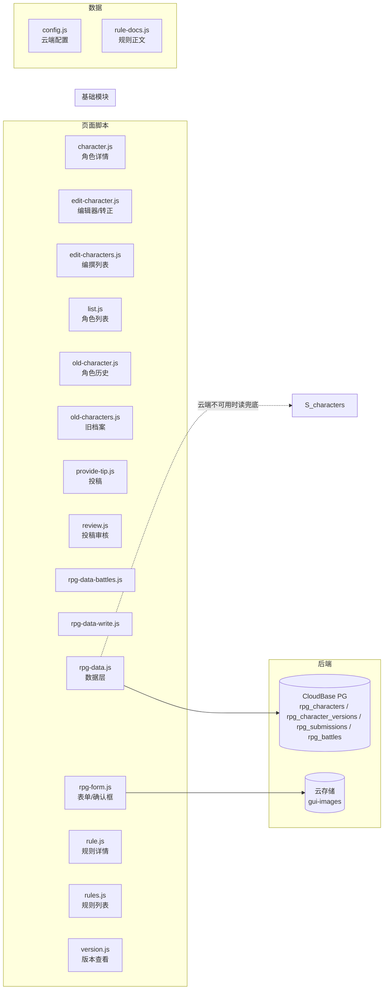

# 回合制正传6.0 角色档案 · 架构图

页面、脚本、数据、后端之间的依赖关系。标记区间由脚本生成、**不要手改**；区间外的说明是手写的。两边冲突时以代码为准。

<!-- AUTO-GENERATED:START 由 _local/tools/build-docs.js 生成，勿手工编辑本区间 -->
**13** 个页面 · **15** 个脚本 · **25** 条依赖边

扫描得到：页面清单、页面→脚本、页面→页面（只认 HTML 里的 href）、脚本→基础模块（按 `window.X` 归属）。
写死的：基础模块之间的边、模块→数据/后端、每页的访问级别。这几处改代码不会自动更新，冲突时以代码为准。

## 一、页面 与 页面脚本

实线 = 页面加载该脚本，虚线 = 页面之间可以互相跳转。

```mermaid
flowchart LR

  subgraph pubLayer["公开页面"]
    P_rpg6_0["rpg6.0.html<br/>角色列表"]
    P_character["character.html<br/>角色详情"]
    P_rules["rules.html<br/>规则列表"]
    P_rule["rule.html<br/>规则详情"]
    P_provide_tip["provide-tip.html<br/>提供投稿"]
    P_test["test.html<br/>对局测试"]
    P_battles["battles.html<br/>战报列表"]
  end

  subgraph editLayer["编辑流程页面"]
    P_edit_characters["edit-characters.html<br/>编撰档案"]
    P_edit_character["edit-character.html<br/>角色编辑器"]
    P_review["review.html<br/>投稿审核"]
    P_old_characters["old-characters.html<br/>旧档案"]
    P_old_character["old-character.html<br/>角色历史"]
    P_version["version.html<br/>版本查看"]
  end

  subgraph scriptLayer["页面脚本"]
    S_character["character.js<br/>角色详情"]
    S_edit_character["edit-character.js<br/>编辑器/转正"]
    S_edit_characters["edit-characters.js<br/>编撰列表"]
    S_list["list.js<br/>角色列表"]
    S_old_character["old-character.js<br/>角色历史"]
    S_old_characters["old-characters.js<br/>旧档案"]
    S_provide_tip["provide-tip.js<br/>投稿"]
    S_review["review.js<br/>投稿审核"]
    S_rpg_data_battles["rpg-data-battles.js"]
    S_rpg_data_write["rpg-data-write.js"]
    S_rpg_data["rpg-data.js<br/>数据层"]
    S_rpg_form["rpg-form.js<br/>表单/确认框"]
    S_rule["rule.js<br/>规则详情"]
    S_rules["rules.js<br/>规则列表"]
    S_version["version.js<br/>版本查看"]
  end

  %% 页面加载自己的脚本

  %% 页面之间的跳转
  P_rpg6_0 -.-> P_rules
  P_rpg6_0 -.-> P_provide_tip
  P_character -.-> P_rpg6_0
  P_rules -.-> P_rpg6_0
  P_rule -.-> P_rpg6_0
  P_rule -.-> P_rules
  P_provide_tip -.-> P_rpg6_0
  P_provide_tip -.-> P_review
  P_test -.-> P_rpg6_0
  P_test -.-> P_rules
  P_test -.-> P_battles
  P_battles -.-> P_rpg6_0
  P_battles -.-> P_rules
  P_battles -.-> P_test
  P_edit_characters -.-> P_review
  P_edit_characters -.-> P_old_characters
  P_edit_characters -.-> P_rpg6_0
  P_edit_character -.-> P_edit_characters
  P_review -.-> P_edit_characters
  P_old_characters -.-> P_edit_characters
  P_old_character -.-> P_old_characters
  P_version -.-> P_old_characters
```



## 二、脚本依赖 与 后端

每个页面只引一个 `<script type="module">` 入口（页面脚本自己 import 数据层与组件）；`rpg-data.js` 以 import 装配 write/battles 两个分片，统一挂 `window.RpgData`。

规则两页不读数据库，只读 `data/rule-docs.js`；正文由开发人员直接改这个文件。

`gui-gate.js`、`gui-upload.js` 与 `guitu/data/config.js` 都是跨模块直接加载，不在本模块目录里，见第五节。



## 三、每个页面加载的脚本

`data/` 是云端表名配置、`seeds/` 33 条兜底角色（仅 3 个公开页直接加载）、`skills/` 技能库（经入口 import）与规则正文；角色页面只读数据库，规则页面只读文件。

| 页面 | config | 该页自己的脚本 |
|---|:-:|---|
| `rpg6.0.html` | ✓ | · |
| `character.html` | ✓ | · |
| `rules.html` | · | · |
| `rule.html` | · | · |
| `provide-tip.html` | ✓ | · |
| `test.html` | ✓ | · |
| `battles.html` | ✓ | · |
| `edit-characters.html` | ✓ | · |
| `edit-character.html` | ✓ | · |
| `review.html` | ✓ | · |
| `old-characters.html` | ✓ | · |
| `old-character.html` | ✓ | · |
| `version.html` | ✓ | · |

上表只列本模块的脚本；跨模块引用见第五节。

## 四、反向依赖（改之前先看影响面）

两张数：有多少页面直接加载它、有多少脚本（含基础模块）依赖它。0 表示没有静态引用——动态加载或运行时读取。

| 文件 | 直接加载它的页面 | 依赖它的脚本 |
|---|---|:-:|
| `config.js` | 11 | 1 |
| `rule-docs.js` | 0 | 2 |

每个页面脚本都只被一个页面加载，改页面脚本只影响那一页。

## 五、跨模块引用

本模块的页面直接加载对方的文件：

| 页面 | 直接加载的文件 |
|---|---|
| `rpg6.0.html` | `guitu/data/config.js`、`js/visit-beacon.js` |
| `character.html` | `guitu/data/config.js`、`js/visit-beacon.js` |
| `provide-tip.html` | `guitu/data/config.js`、`guitu/js/gui-upload.js`、`js/visit-beacon.js` |
| `test.html` | `js/visit-beacon.js`、`guitu/data/config.js` |
| `battles.html` | `js/visit-beacon.js`、`guitu/data/config.js` |
| `edit-characters.html` | `js/members.js`、`js/operator.js`、`js/edit-log.js`、`guitu/data/config.js`、`guitu/js/gui-gate.js` |
| `edit-character.html` | `js/members.js`、`js/operator.js`、`js/edit-log.js`、`guitu/data/config.js`、`guitu/js/gui-gate.js` |
| `review.html` | `js/members.js`、`js/operator.js`、`js/edit-log.js`、`guitu/data/config.js`、`guitu/js/gui-gate.js` |
| `old-characters.html` | `js/members.js`、`js/operator.js`、`js/edit-log.js`、`guitu/data/config.js`、`guitu/js/gui-gate.js` |
| `old-character.html` | `js/members.js`、`js/operator.js`、`js/edit-log.js`、`guitu/data/config.js`、`guitu/js/gui-gate.js` |
| `version.html` | `js/members.js`、`js/operator.js`、`js/edit-log.js`、`guitu/data/config.js`、`guitu/js/gui-gate.js` |

页面直接加载 `../guitu/data/config.js`、`../guitu/js/gui-gate.js` 与 `../guitu/js/gui-upload.js`；改这三个文件会同时影响鬼图鉴、异常区域档案与站点建议。
<!-- AUTO-GENERATED:END -->

---

## 怎么更新

改完代码后执行一次生成脚本，只覆盖上面的标记区间：

```
node _local/tools/build-docs.js
```

## 怎么读

| 层 | 内容 |
|---|---|
| 数据 | 云端表名配置、33 条兜底角色、规则正文 |
| 基础模块 | 数据层、表单组件（被多个页面共用） |
| 页面脚本 | 每页自己的逻辑，互不依赖；规则两页只读 `data/rule-docs.js` |
| 公开页面 | 不需要验证：列表、详情、规则、投稿、对局测试 |
| 编辑流程页面 | 需要组织验证：编撰、审核、旧档案、版本 |
| 后端 | CloudBase PostgreSQL 与云存储 |

面向访客的界面跳转图见 [访客流程图.md](访客流程图.md)。
模块说明、五条硬规则与踩坑记录见 [README.md](README.md)。

## 战斗引擎（不在上面的脚本表里）

`test.html` 只引一个模块入口 `js/battle/entry.js`，引擎、技能库与数据访问层由它 import；另外还挂了几个经典 `<script>`（访问埋点、云端配置、种子数据）。其余页面同样每页一个模块入口。生成脚本只扫模块根下的 `js/*.js`，所以这些文件不出现在第三节的表与图里。结构是：

| 目录 | 内容 |
|---|---|
| `js/engine/` | 纯函数引擎，不碰 DOM，可以在 node 里跑；`index.js` 是唯一权威的加载顺序（看该文件，别在这里抄一份），`ops/*` 里 <!-- RPG6-STATS:START ops -->38<!-- RPG6-STATS:END ops --> 个 op 按伤害/状态/流程拆成三份 |
| `js/battle/` | 界面：`entry.js` 单入口、`battle-view.js` 渲染、`battle-pick.js` 选中状态、`battle-page.js` 装配与调度 |
| `data/skills/` | 角色技能、marks 与 summons 的结构化数据：一个角色一个文件，`index.js` 聚合出 `{version, marks, summons, characters}`；条件文本必须与档案一致，否则该技能被禁用 |
| `css/battle.css` | 对局页样式，只引用 `css/style.css` 的 token |

引擎单测：`node _local/tests/engine/run.mjs`。
规则裁定与技能逐条结算：`_local/docs/回合制6.0测试功能-plan.md`、`_local/docs/回合制6.0测试功能-角色机制.md`。
对局功能的完整交接说明（玩法、技能库怎么加、测试与已知问题）见 [游戏说明.md](游戏说明.md)。