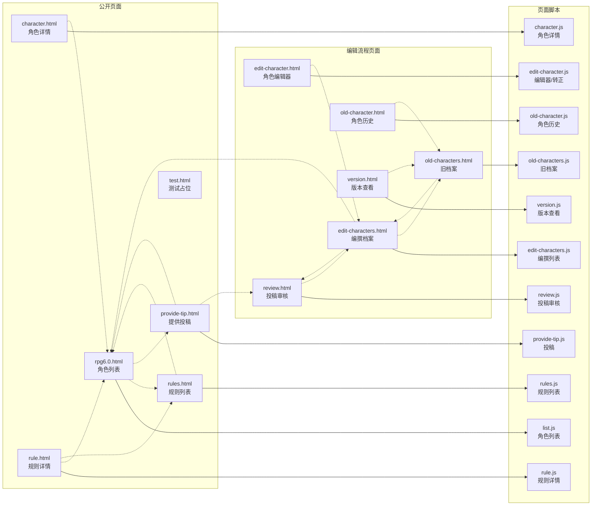
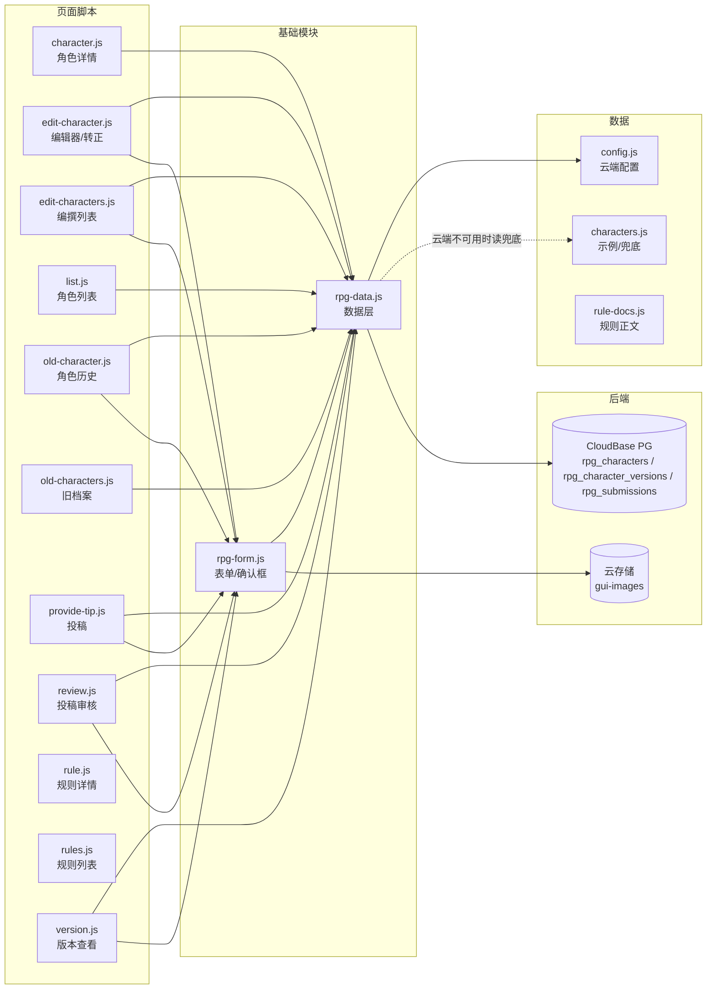

# 回合制正传6.0 角色档案 · 架构图

页面、脚本、数据、后端之间的依赖关系。标记区间由脚本生成、**不要手改**；区间外的说明是手写的。两边冲突时以代码为准。

<!-- AUTO-GENERATED:START 由 _local/tools/build-docs.js 生成，勿手工编辑本区间 -->
**12** 个页面 · **13** 个脚本 · **47** 条依赖边

扫描得到：页面清单、页面→脚本、页面→页面（只认 HTML 里的 href）、脚本→基础模块（按 `window.X` 归属）。
写死的：基础模块之间的边、模块→数据/后端、每页的访问级别。这几处改代码不会自动更新，冲突时以代码为准。

## 一、页面 与 页面脚本

实线 = 页面加载该脚本，虚线 = 页面之间可以互相跳转。



## 二、脚本依赖 与 后端

页面脚本只依赖 `rpg-data.js` 与 `rpg-form.js`，彼此之间**没有任何横向依赖**。

规则两页不读数据库，只读 `data/rule-docs.js`；正文由开发人员直接改这个文件。

`gui-gate.js`、`gui-upload.js` 与 `guitu/data/config.js` 都是跨模块直接加载，不在本模块目录里，见第五节。



## 三、每个页面加载的脚本

`data/` 是云端表名配置、33 条兜底数据与规则正文；角色页面只读数据库，规则页面只读文件。

| 页面 | characters | config | rule-docs | rpg-data | rpg-form | 该页自己的脚本 |
|---|:-:|:-:|:-:|:-:|:-:|---|
| `rpg6.0.html` | ✓ | ✓ | · | ✓ | · | `list.js` |
| `character.html` | ✓ | ✓ | · | ✓ | · | `character.js` |
| `rules.html` | · | · | ✓ | · | · | `rules.js` |
| `rule.html` | · | · | ✓ | · | · | `rule.js` |
| `provide-tip.html` | · | ✓ | · | ✓ | ✓ | `provide-tip.js` |
| `test.html` | · | · | · | · | · | · |
| `edit-characters.html` | · | ✓ | · | ✓ | ✓ | `edit-characters.js` |
| `edit-character.html` | · | ✓ | · | ✓ | ✓ | `edit-character.js` |
| `review.html` | · | ✓ | · | ✓ | ✓ | `review.js` |
| `old-characters.html` | · | ✓ | · | ✓ | · | `old-characters.js` |
| `old-character.html` | · | ✓ | · | ✓ | ✓ | `old-character.js` |
| `version.html` | · | ✓ | · | ✓ | ✓ | `version.js` |

上表只列本模块的脚本；跨模块引用见第五节。

## 四、反向依赖（改之前先看影响面）

两张数：有多少页面直接加载它、有多少脚本（含基础模块）依赖它。0 表示没有静态引用——动态加载或运行时读取。

| 文件 | 直接加载它的页面 | 依赖它的脚本 |
|---|---|:-:|
| `rpg-data.js` | 9 | 10 |
| `rpg-form.js` | 6 | 6 |
| `characters.js` | 2 | 1 |
| `config.js` | 9 | 1 |
| `rule-docs.js` | 2 | 2 |

每个页面脚本都只被一个页面加载，改页面脚本只影响那一页。

## 五、跨模块引用

本模块的页面直接加载对方的文件：

| 页面 | 直接加载的文件 |
|---|---|
| `rpg6.0.html` | `guitu/data/config.js` |
| `character.html` | `guitu/data/config.js` |
| `provide-tip.html` | `guitu/data/config.js`、`guitu/js/gui-upload.js` |
| `edit-characters.html` | `guitu/data/config.js`、`guitu/js/gui-gate.js` |
| `edit-character.html` | `guitu/data/config.js`、`guitu/js/gui-gate.js` |
| `review.html` | `guitu/data/config.js`、`guitu/js/gui-gate.js` |
| `old-characters.html` | `guitu/data/config.js`、`guitu/js/gui-gate.js` |
| `old-character.html` | `guitu/data/config.js`、`guitu/js/gui-gate.js` |
| `version.html` | `guitu/data/config.js`、`guitu/js/gui-gate.js` |

页面直接加载 `../guitu/data/config.js`、`../guitu/js/gui-gate.js` 与 `../guitu/js/gui-upload.js`；改这三个文件会同时影响鬼图鉴、异常区域档案与站点建议。
<!-- AUTO-GENERATED:END -->

---

## 怎么更新

改完代码后执行一次生成脚本，只覆盖上面的标记区间：

```
node _local/tools/build-docs.js
```

## 怎么读

| 层 | 内容 |
|---|---|
| 数据 | 云端表名配置、33 条兜底角色、规则正文 |
| 基础模块 | 数据层、表单组件（被多个页面共用） |
| 页面脚本 | 每页自己的逻辑，互不依赖；规则两页只读 `data/rule-docs.js` |
| 公开页面 | 不需要验证：列表、详情、规则、投稿、测试占位 |
| 编辑流程页面 | 需要组织验证：编撰、审核、旧档案、版本 |
| 后端 | CloudBase PostgreSQL 与云存储 |

面向访客的界面跳转图见 [访客流程图.md](访客流程图.md)。
模块说明、三条硬规则与踩坑记录见 [README.md](README.md)。