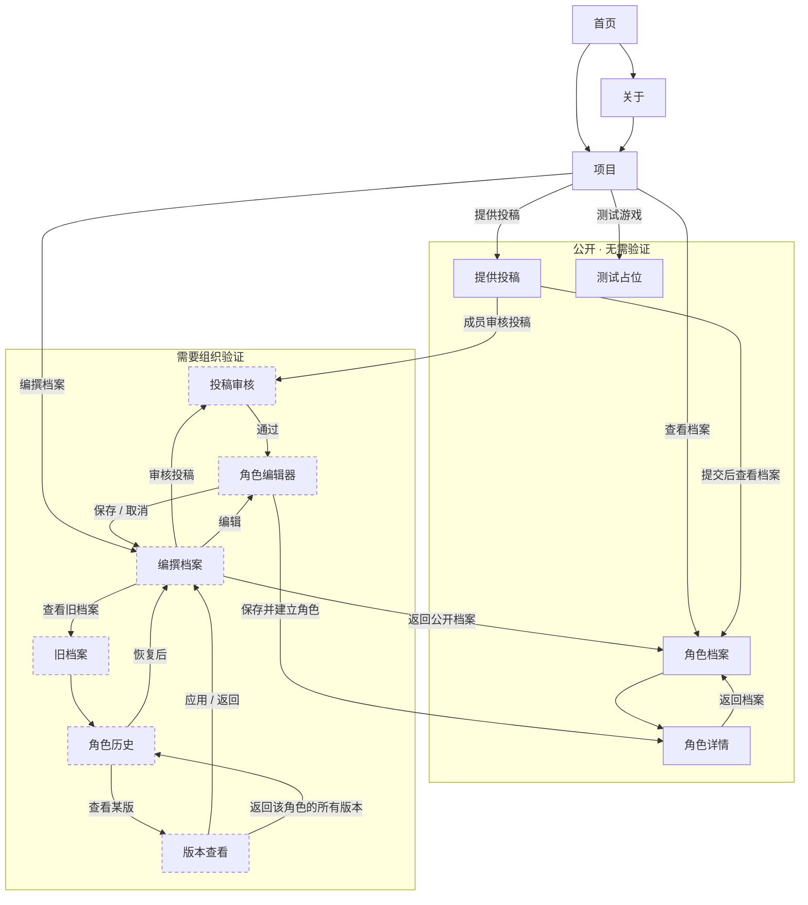

# 回合制正传6.0 角色档案 · 界面跳转

这张图只说明**界面上点哪里能到哪里**，不涉及代码、数据库和服务器。

每个页面顶部的「首页 / 关于 / 项目」导航是所有页面都有的，为了画面清爽没有逐条画出。

## 怎么读

| 记号 | 含义 |
|---|---|
| 实线箭头 | 点按钮或链接可以过去 |
| 箭头上的文字 | 那个按钮叫什么 |
| 虚线边框 | 进去之前要先回答组织验证问题 |

## 几条主要路径

**查阅**：项目 → 查看档案 → 点某个角色看详情；图片在详情页底部折叠，默认收起。

**投稿**：项目 → 提供投稿 → 填写并上传图片，不需要验证。

**审核**：项目 → 编撰档案（答验证题）→ 审核投稿 → 通过后进预填编辑器，选审核人与审核评价，保存即建立角色。

**修改**：编撰档案 → 编辑 → 改完保存；旧内容进旧档案。图片不能在这里改。

**删错了想撤回**：编撰档案 → 旧档案 → 点角色 → 选某个历史版本 → 应用，或直接恢复已删除的角色。
