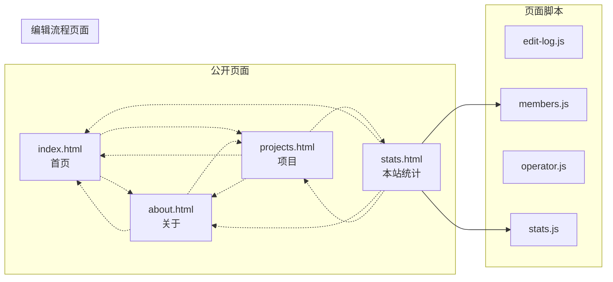
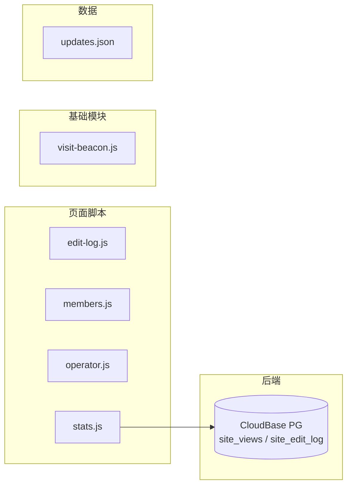

# 网站主站 · 架构图

> 冻结于 2026-11-24：文档生成已停，本文件不再随源码更新；内容以代码为准。

页面、脚本、数据、后端之间的依赖关系。标记区间由脚本生成、**不要手改**；区间外的说明是手写的。两边冲突时以代码为准。

<!-- AUTO-GENERATED:START 由 _local/tools/build-docs.js 生成，勿手工编辑本区间 -->
**4** 个页面 · **5** 个脚本 · **13** 条依赖边

扫描得到：页面清单、页面→脚本、页面→页面（只认 HTML 里的 href）、脚本→基础模块（按 `window.X` 归属）。
写死的：基础模块之间的边、模块→数据/后端、每页的访问级别。这几处改代码不会自动更新，冲突时以代码为准。

## 一、页面 与 页面脚本

实线 = 页面加载该脚本，虚线 = 页面之间可以互相跳转。



## 二、脚本依赖 与 后端

主站页面只加载两个全站脚本：`guitu/data/config.js`（云端地址与可公开密钥）与 `js/visit-beacon.js`（访问打点）。

提建议与审核建议在 `suggest/` 模块里；`stats.html` 另外加载 `js/members.js` 与 `js/stats.js`。



## 三、每个页面加载的脚本

主站有 `data/updates.json`（手工维护的功能更新记录），云端数据只由 `stats.html` 通过 RPC 读聚合结果。

| 页面 | visit-beacon | 该页自己的脚本 |
|---|:-:|---|
| `index.html` | ✓ | · |
| `about.html` | ✓ | · |
| `projects.html` | ✓ | · |
| `stats.html` | ✓ | `members.js, stats.js` |

上表只列本模块的脚本；跨模块引用见第五节。

## 四、反向依赖（改之前先看影响面）

两张数：有多少页面直接加载它、有多少脚本（含基础模块）依赖它。0 表示没有静态引用——动态加载或运行时读取。

| 文件 | 直接加载它的页面 | 依赖它的脚本 |
|---|---|:-:|
| `visit-beacon.js` | 4 | 0 |
| `updates.json` | 0 | 0 |

每个页面脚本都只被一个页面加载，改页面脚本只影响那一页。

## 五、跨模块引用

本模块的页面直接加载对方的文件：

| 页面 | 直接加载的文件 |
|---|---|
| `index.html` | `guitu/data/config.js` |
| `about.html` | `guitu/data/config.js` |
| `projects.html` | `guitu/data/config.js` |
| `stats.html` | `guitu/data/config.js` |

主站直接加载 `guitu/data/config.js`（云端地址与可公开密钥）与 `js/` 下的全站脚本；改这几处会同时影响主站与各模块。
<!-- AUTO-GENERATED:END -->

---

## 怎么更新

改完代码后执行一次生成脚本，只覆盖上面的标记区间：

```
node _local/tools/build-docs.js
```

## 怎么读

| 层 | 内容 |
|---|---|
| 数据 | 无 data/ 目录；配置跨模块读 `guitu/data/config.js` |
| 基础模块 | `suggest-data.js` 由两个建议页共用 |
| 页面脚本 | 建议表单、建议审核，各服务一个页面 |
| 公开页面 | 不需要验证，任何人可看 |
| 编辑流程页面 | 审核建议要先答验证题 |
| 后端 | CloudBase PostgreSQL 的 `site_suggestions` 表 |

面向访客的界面跳转图见 [访客流程图.md](访客流程图.md)。
部署与目录说明见 [README.md](README.md)。