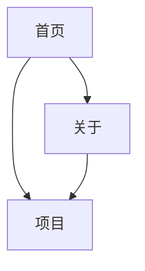

# 网站主站 · 界面跳转

这张图只说明主站三页之间的跳转；建议入口在 `suggest/` 模块的访客流程图里。

每个页面顶部的「首页 / 关于 / 项目」导航是所有页面都有的，为了画面清爽没有逐条画出。

## 怎么读

| 记号 | 含义 |
|---|---|
| 实线箭头 | 点按钮或链接可以过去 |

## 几条主要路径

**浏览主站**：首页 → 关于 / 项目，彼此都能互相跳转。
