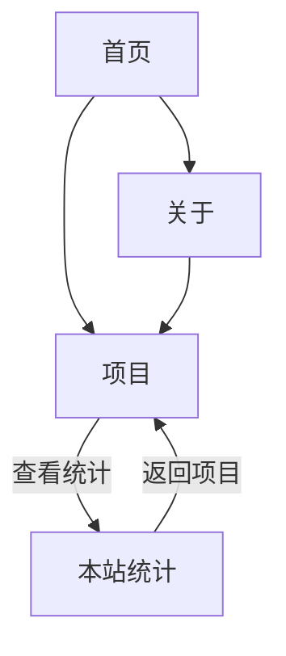

# 网站主站 · 界面跳转

> 冻结于 2026-11-24：文档生成已停，本文件不再随源码更新；内容以代码为准。

这张图只说明主站页面之间的跳转；建议入口在 `suggest/` 模块的访客流程图里。

每个页面顶部的「首页 / 关于 / 项目」导航是所有页面都有的，为了画面清爽没有逐条画出。

## 怎么读

| 记号 | 含义 |
|---|---|
| 实线箭头 | 点按钮或链接可以过去 |

## 几条主要路径

**浏览主站**：首页 → 关于 / 项目，彼此都能互相跳转。

**看本站统计**：项目 → 第一张卡片「查看统计」→ 流量 / 更新记录 / 成员贡献度。
