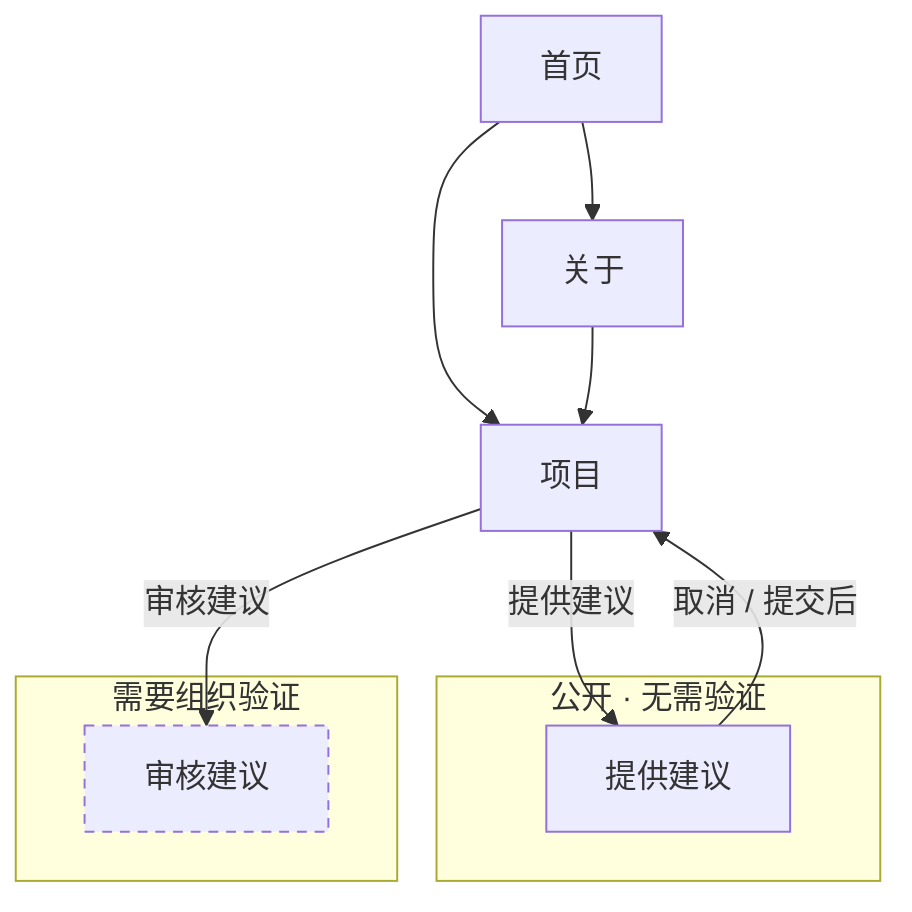

# 网站主站 · 界面跳转

这张图只说明主站三页与建议入口的跳转；两个模块内部的跳转见各自目录的访客流程图。

每个页面顶部的「首页 / 关于 / 项目」导航是所有页面都有的，为了画面清爽没有逐条画出。

## 怎么读

| 记号 | 含义 |
|---|---|
| 实线箭头 | 点按钮或链接可以过去 |
| 箭头上的文字 | 那个按钮叫什么 |
| 虚线边框 | 进去之前要先回答组织验证问题 |

## 几条主要路径

**提建议**：项目 → 提供建议 → 填写提交，不需要验证。

**审核建议**：项目 → 审核建议（答验证题）→ 逐条处理或删除。
